# Thrift Shop Inventory Tracker - Database Diagram & Architecture

This database schema is designed for **Supabase (PostgreSQL)**, specifically tailored for a thrift shop workflow where inventory is sourced by opening **bals (bales)**, sorted by **clothing category** and **grade**, and tracked through stock in, retail sales, and stock adjustments.

---

## 1. Entity Relationship (ER) Diagram

```mermaid
erDiagram
    BALES ||--o{ BAL_UNPACK_ITEMS : "yields"
    CATEGORIES ||--o{ INVENTORY_STOCKS : "classified by"
    GRADES ||--o{ INVENTORY_STOCKS : "graded as"
    CATEGORIES ||--o{ BAL_UNPACK_ITEMS : "categorizes"
    GRADES ||--o{ BAL_UNPACK_ITEMS : "graded as"
    CATEGORIES ||--o{ SALE_ITEMS : "sold as"
    GRADES ||--o{ SALE_ITEMS : "sold as"
    SALES ||--o{ SALE_ITEMS : "contains"
    CATEGORIES ||--o{ STOCK_MOVEMENTS : "targets"
    GRADES ||--o{ STOCK_MOVEMENTS : "targets"
    CATEGORIES ||--o{ STOCK_ADJUSTMENTS : "adjusts"
    GRADES ||--o{ STOCK_ADJUSTMENTS : "adjusts"

    BALES {
        uuid id PK
        varchar bal_code "Unique bale identifier/tag"
        varchar description "e.g. Vintage USA Jackets 100kg"
        numeric purchase_cost "Total cost to acquire bal"
        varchar status "unopened, opened, completed"
        timestamptz opened_at "When bal was unsealed"
        timestamptz created_at
    }

    CATEGORIES {
        uuid id PK
        varchar name "Jeans, T-Shirt, Jacket, Flannel, etc."
        text description
        boolean is_active
        timestamptz created_at
    }

    GRADES {
        uuid id PK
        varchar code "Grade A, Grade B, Grade C / Reject, Head, etc."
        int sort_order "Sorting display priority"
        text description
        boolean is_active
        timestamptz created_at
    }

    INVENTORY_STOCKS {
        uuid id PK
        uuid category_id FK "Unique pair with grade_id"
        uuid grade_id FK
        int current_quantity "Current items available in shop"
        numeric default_price "Default selling price"
        int low_stock_threshold "Alert threshold"
        timestamptz updated_at
    }

    BAL_UNPACK_ITEMS {
        uuid id PK
        uuid bal_id FK "Source bal"
        uuid category_id FK
        uuid grade_id FK
        int quantity "Count unpacked into this grade"
        text notes
        timestamptz created_at
    }

    SALES {
        uuid id PK
        varchar receipt_no "Optional receipt / transaction #"
        numeric total_amount "Total revenue of transaction"
        varchar payment_method "cash, qris, transfer"
        timestamptz sale_date
        text notes
        timestamptz created_at
    }

    SALE_ITEMS {
        uuid id PK
        uuid sale_id FK
        uuid category_id FK
        uuid grade_id FK
        int quantity "Count of items sold"
        numeric unit_price "Actual sold unit price"
        numeric subtotal "quantity * unit_price"
    }

    STOCK_ADJUSTMENTS {
        uuid id PK
        uuid category_id FK
        uuid grade_id FK
        int quantity_change "Signed integer (+/-)"
        varchar reason "damaged, lost, audit_correction, donated"
        text notes
        timestamptz created_at
    }

    STOCK_MOVEMENTS {
        uuid id PK
        uuid category_id FK
        uuid grade_id FK
        varchar movement_type "STOCK_IN_BAL, STOCK_OUT_SALE, ADJUSTMENT"
        int quantity_change "Signed: +in, -out"
        uuid reference_id "FK to bal_unpack_item, sale_item, or adjustment"
        varchar reference_type "bal_unpack, sale, adjustment"
        text notes
        timestamptz created_at
    }
```

---

## 2. Core Workflow & Table Design

### A. Bale Unpacking (Stock In)
* **`bales`**: Represents a physical bundle purchased (e.g., *Bal #04 - Japan Knitwear, Cost: Rp 4,500,000*). Tracks acquisition cost so you can calculate overall profit margins.
* **`bal_unpack_items`**: When a bal is cut open, staff sorts items into piles:
  * e.g., 25x Flannel Grade A, 40x Flannel Grade B, 5x Flannel Reject.
  * Logging this automatically triggers a `STOCK_IN_BAL` movement and increments `inventory_stocks`.

### B. Fast Sales (Stock Out)
* Thrift shops don't have individual barcodes on every piece. Cashiers ring up sales by **Category + Grade**:
  * e.g., *1x Jeans Grade A @ Rp 120,000* + *2x T-Shirt Grade B @ Rp 45,000*.
* Stored in **`sales`** and **`sale_items`**, automatically decrementing `inventory_stocks`.

### C. Adjustments (Shrinkage & Damage)
* Items stained, torn, lost, or donated out of the store are logged in **`stock_adjustments`** with reasons (`damaged`, `lost`, `audit_recount`).

### D. Single Source of Truth (`stock_movements` & `inventory_stocks`)
* **`inventory_stocks`** holds the current real-time quantity for instant querying in the frontend UI.
* **`stock_movements`** is the immutable audit ledger. If there's ever a count dispute, replaying all movements gives the exact historical truth.

---

## 3. Recommended Supabase Features

1. **Row Level Security (RLS)**: Can easily be enabled for staff vs. owner roles.
2. **Auto-updating Stock Trigger**: A PostgreSQL trigger can automatically update `inventory_stocks.current_quantity` whenever a row is inserted into `stock_movements`.
3. **Profit Tracking View**: Compare `SUM(purchase_cost)` of opened bales vs. `SUM(total_amount)` of sales.
