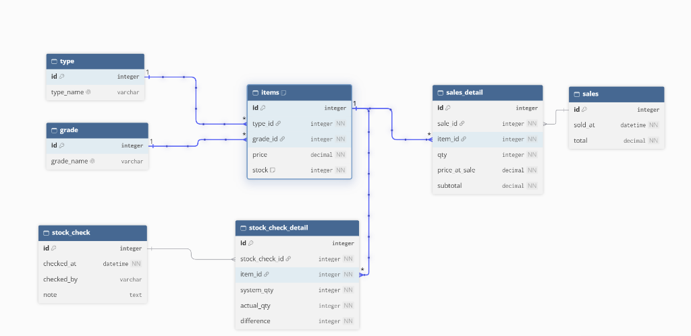
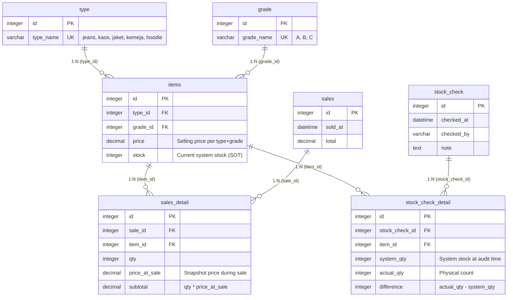

# Thrift Shop Inventory & POS Prototype

A modern, responsive Next.js Inventory & Point of Sale (POS) application built with local SQLite persistence via Prisma ORM. Tailored specifically for thrift shop workflows tracking clothing categories, condition grades, real-time stock levels, POS sales transactions, and physical stock audits (Stock Opname).

---

## 📊 Entity Relationship Diagram (ERD)





---

## 🗄️ Database Tables Overview

| Table | Description |
| :--- | :--- |
| **`type`** | Master clothing category (e.g. *jeans*, *kaos*, *jaket*, *kemeja*, *hoodie*). |
| **`grade`** | Master quality / condition tiers (e.g. *Grade A*, *Grade B*, *Grade C*). |
| **`items`** | Unique combination of `(type_id, grade_id)`. Holds selling price and current live stock (Single Source of Truth). |
| **`sales`** | Transaction header recording checkout time (`sold_at`) and grand total (`total`). |
| **`sales_detail`** | Line items for each sale. Stores quantity (`qty`), snapshot price (`price_at_sale`), and line subtotal. |
| **`stock_check`** | Stock Opname audit header recording timestamp (`checked_at`), auditor name (`checked_by`), and notes. |
| **`stock_check_detail`** | Line items per audited item, comparing `system_qty` with `actual_qty` and recording variance (`difference`). |

---

## 🚀 Key Features

1. **Dedicated Stock Intake Form (`/inventory`)**:
   - Add new arrivals (`+qty`) or directly override/set initial stock count (`=qty`).
   - Adjust unit selling prices and add audit arrival notes.
   - Low-stock warning indicators (≤ 5 pcs) and out-of-stock badges.

2. **Strict POS Cashier Register (`/pos`)**:
   - Quick touch & keyboard-friendly category and grade selector.
   - **Strict Oversell Protection**: Checkout is blocked if cart quantity exceeds current stock.
   - Atomic database transactions ensure immediate stock decrement and snapshotting of `price_at_sale`.
   - Printable receipt modal summary.

3. **Stock Opname with "Match / Reconcile" Option (`/stock-check`)**:
   - Audits physical store count against system stock in real-time.
   - Live color-coded variance calculation:
     - 🟩 `0`: Pas / Sesuai
     - 🟥 `< 0`: Selisih Kurang (Hilang / Rusak)
     - 🟦 `> 0`: Selisih Lebih
   - **Reconcile Toggle**: Check `[x] Sinkronkan & Samakan Stok Sistem` to automatically update `items.stock = actual_qty`, or uncheck to keep purely as an audit history log.

4. **Executive Dashboard (`/`)**:
   - Real-time inventory valuation (`SUM(stock * price)`).
   - Total physical pieces in stock, today's sales revenue, and recent transaction feeds.

---

## 🛠️ Tech Stack

- **Framework**: [Next.js](https://nextjs.org/) (App Router, TypeScript, React 19)
- **Styling**: [Tailwind CSS v4](https://tailwindcss.com/)
- **Icons**: [Lucide React](https://lucide.dev/)
- **Database & ORM**: [Prisma ORM](https://www.prisma.io/) with local **SQLite** (`prisma/dev.db`)

---

## ⚡ Getting Started

### 1. Install Dependencies
```bash
npm install
```

### 2. Initialize Database & Seed
```bash
# Push Prisma schema to SQLite
npx prisma db push

# Seed master types, grades, and items
npm run db:seed
```

### 3. Run Development Server
```bash
npm run dev
```

Open [http://localhost:3000](http://localhost:3000) in your browser.

---

## 🧪 Running Automated Tests

Run the end-to-end integration tests (testing stock intake, POS oversell guards, checkout decrements, and audit reconciliation):
```bash
npx tsx test_app.ts
```
